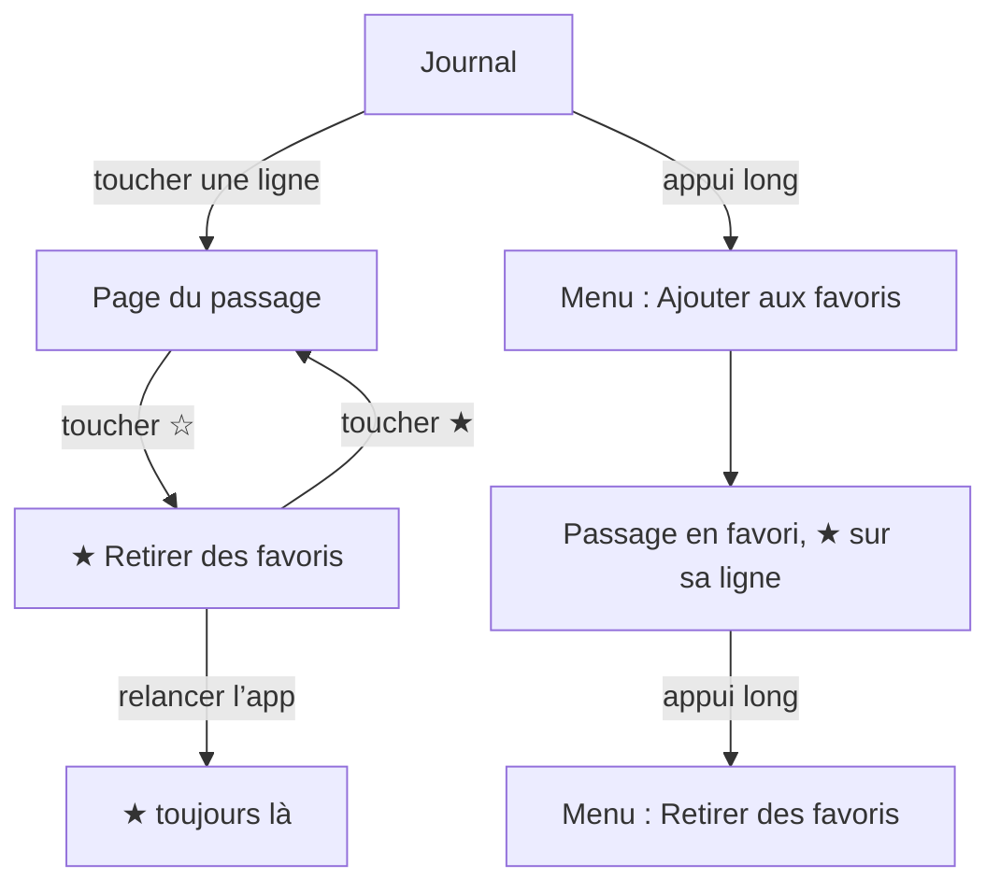
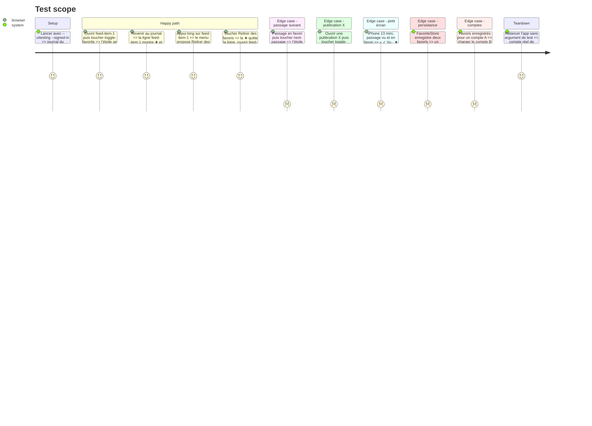

# Instruction: Mettre un passage en favori

## Architecture projection

> Tree of the final files. ✅ create · ✏️ modify · ❌ delete

```txt
.
├── Infometrie/Core/
│   └── FavoriteStore.swift              ✅ favori (copie du passage, date d’ajout, « plus disponible »), stockage par compte
├── Infometrie/Services/
│   └── AppModel.swift                   ✏️ favoris chargés, ajoutés, retirés, vidés en mémoire à la déconnexion
├── Infometrie/Views/
│   ├── PlayerViews.swift                ✏️ étoile dans la barre de la page du passage
│   ├── FeedView.swift                   ✏️ « Ajouter aux favoris » à l’appui long et en action VoiceOver, étoile sur les lignes
│   ├── FeedCard.swift                   ✏️ « ★ » dans la ligne des faits d’un passage en favori
│   └── PersonView.swift                 ✏️ étoile sur les lignes du jour d’une fiche, comme dans le journal
├── Infometrie/Fixtures/
│   └── UITestServer.swift               ✏️ chaque lancement de test vide les favoris du compte de test
├── Tests/InfometrieCoreTests/
│   └── FavoriteStoreTests.swift         ✅ aller-retour, comptes séparés, données illisibles, « plus disponible »
└── aidd_docs/memory/
    └── mobile.md                        ✏️ favoris dans « State and storage »
```

## User Journey



## Test Scope



## Wireframe

```txt
┌───────────────────────────────────────┐
│ (‹)          Séquence           (1)(☆)│
│ Intervention  09/10 14:52 · 1:24 [logo]│
│ Camille Martin · TEST-A               │
│ Titre du passage                      │
│ …                                     │
└───────────────────────────────────────┘

Ligne du journal d’un passage en favori :
┌───────────────────────────────────────┐
│ ┃ Intervention 14:52 · 1:24 · ✓ Vu · ★ (3) [logo]
│ ┃ Camille Martin · TEST-A             │
│ ┃ Titre du passage                    │
└───────────────────────────────────────┘

Appui long sur une ligne du journal :
┌───────────────────────────────┐
│ ✓ Marquer comme vu            │
│ (2) ☆ Ajouter aux favoris     │
│ Voir la fiche de …            │
└───────────────────────────────┘
```

1. Étoile en cercle de verre, à droite de la barre, comme la croix de « Tout écouter » : vide hors favoris, pleine en favori.
2. Entrée du menu d’appui long, devient « Retirer des favoris » quand le passage est en favori.
3. Étoile pleine, seule, en fin de ligne des faits : dit « en favori » sans ouvrir le passage.

## Tasks to do

### `1)` Stockage des favoris dans Core

> Un favori se garde par compte sur l’appareil et sait s’il est sorti de l’historique, testé sans simulateur.

1. Créer `Infometrie/Core/FavoriteStore.swift`, Foundation seul.
2. `Favorite` : `item: FeedItem`, `addedAt: Date`, `id` = `item.id` ; `isUnavailable(now:)` vrai quand le jour de Paris du passage précède `FeedPeriod.oldestDay(now:)`, faux sans date lisible.
3. `FavoriteStore` sur le modèle de `SearchStore` : clé `favorite-passages.` + compte normalisé en base64, `load` et `save` qui lèvent, `clear`.
4. `FavoriteStoreTests.swift` : aller-retour, deux comptes séparés, données illisibles qui lèvent, « plus disponible » au bord des 60 jours et sans date.

### `2)` Favoris dans le modèle

> Ajouter ou retirer un favori est immédiat et persiste.

1. Dans `AppModel`, `favorites: [Favorite]` en lecture seule, les derniers ajoutés en premier.
2. Charger dans `loadSearches()` à côté de `seen` ; illisibles : liste vide et `notice` « Les favoris n’ont pas pu être lus. ».
3. `isFavorite(_:)`, `toggleFavorite(_:)` (ajoute en tête avec la date du jour, ou retire), `removeFavorite(_:)` ; sans compte, ne rien faire.
4. Enregistrer après chaque changement ; en cas d’échec, `notice` « Impossible d’enregistrer vos favoris sur cet appareil. ».
5. `resetContent()` vide les favoris en mémoire, jamais sur l’appareil.

### `3)` Étoile sur la page du passage

> Le geste principal, là où l’on vient de lire ou d’écouter.

1. Dans `SequenceView`, `ToolbarItem(placement: .topBarTrailing)` : `Button` avec `star` ou `star.fill`, fond de verre partagé par défaut, ni `.confirmationAction` ni `role: .close`.
2. Libellé VoiceOver « Ajouter aux favoris » / « Retirer des favoris », identifiant `toggle-favorite`.
3. Étoile en `Brand.accent` quand elle est pleine, `Brand.ink` sinon ; `symbolEffect(.replace)` et `.sensoryFeedback(.selection)` au toucher.
4. L’étoile suit `item`, donc le passage affiché après « Passage suivant » ; même barre sur une publication X.

### `4)` Favori depuis le journal

> Garder un passage sans l’ouvrir.

1. Dans le `contextMenu` des lignes de `FeedView`, après `seenToggle`, ajouter « Ajouter aux favoris » (`star`) / « Retirer des favoris » (`star.slash`).
2. Même choix en `accessibilityAction(named:)` sur la ligne.

### `5)` Étoile sur les lignes

> Voir depuis le journal ce qu’on a déjà gardé.

1. `FeedCard` : paramètre `favorite`, qui ajoute `star.fill` seul en `Brand.accent` après « ✓ Vu », dans le même `Text` que les faits (une ligne, règle de l’audit du 2026-10-10).
2. Valeur VoiceOver « Favori », après « Déjà vu » quand les deux s’appliquent ; la date et la durée lues restent inchangées.
3. `FeedView` et la liste du jour de `PersonView` passent `model.isFavorite(item)`.
4. Rien d’autre ne change sur la ligne : ni couleur, ni graisse, ni ordre.

### `6)` Tests et mémoire

> Les tests restent indépendants, le stockage est documenté.

1. Dans `UITestServer.makeAppModel`, vider les favoris du compte de test à chaque lancement, comme `SeenStore`.
2. `mobile.md`, « State and storage » : favoris par compte (`FavoriteStore`), copie du passage, gardés à la déconnexion, pas de synchronisation.
3. `design.md`, métadonnées des lignes (`FeedCard`) : « ★ » après « ✓ Vu », valeur VoiceOver « Favori ».

## Test acceptance criteria

| Task | Acceptance criteria |
| ---- | ------------------- |
| 1 | `swift test` couvre l’aller-retour, la séparation des comptes, les données illisibles et la limite de « plus disponible ». |
| 2 | Toucher deux fois l’étoile laisse le passage hors favoris ; un favori survit à une relance de l’app et à une déconnexion suivie d’une reconnexion au même compte (vérifié sur le simulateur avec le compte réel, les lancements de test vidant les favoris). |
| 3 | Sur la page d’un passage, l’étoile se remplit au toucher et VoiceOver lit « Retirer des favoris » ; après « Passage suivant », elle reflète le nouveau passage. |
| 4 | L’appui long sur une ligne du journal propose « Ajouter aux favoris », puis « Retirer des favoris » une fois ajouté. |
| 5 | Une ligne du journal ou du jour d’une fiche montre « ★ » dès que son passage est en favori et la perd dès qu’il en sort ; VoiceOver lit « Favori » ; la ligne reste sans troncature sur l’iPhone 13 mini. |
| 6 | Un lancement `--uitesting` démarre sans favori ; `mobile.md` et `design.md` décrivent le stockage et l’étoile. |
