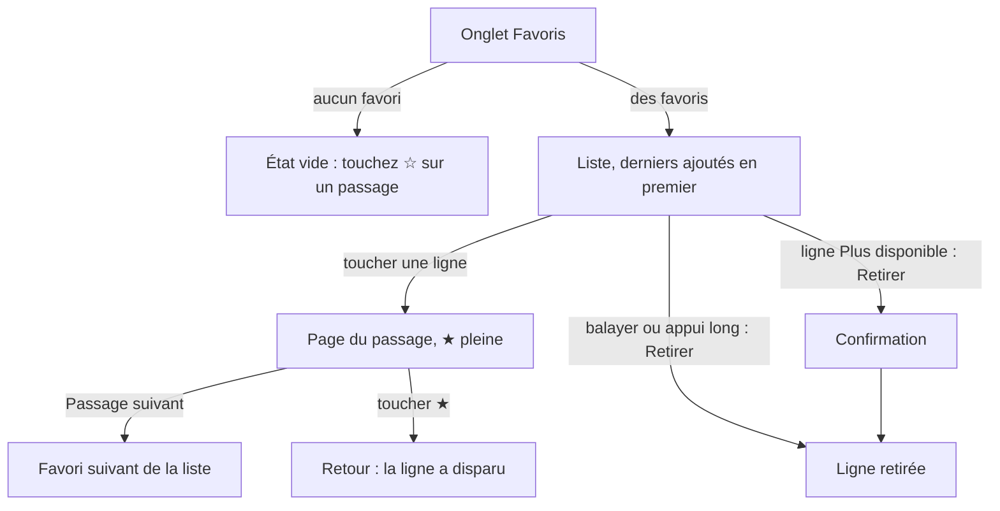
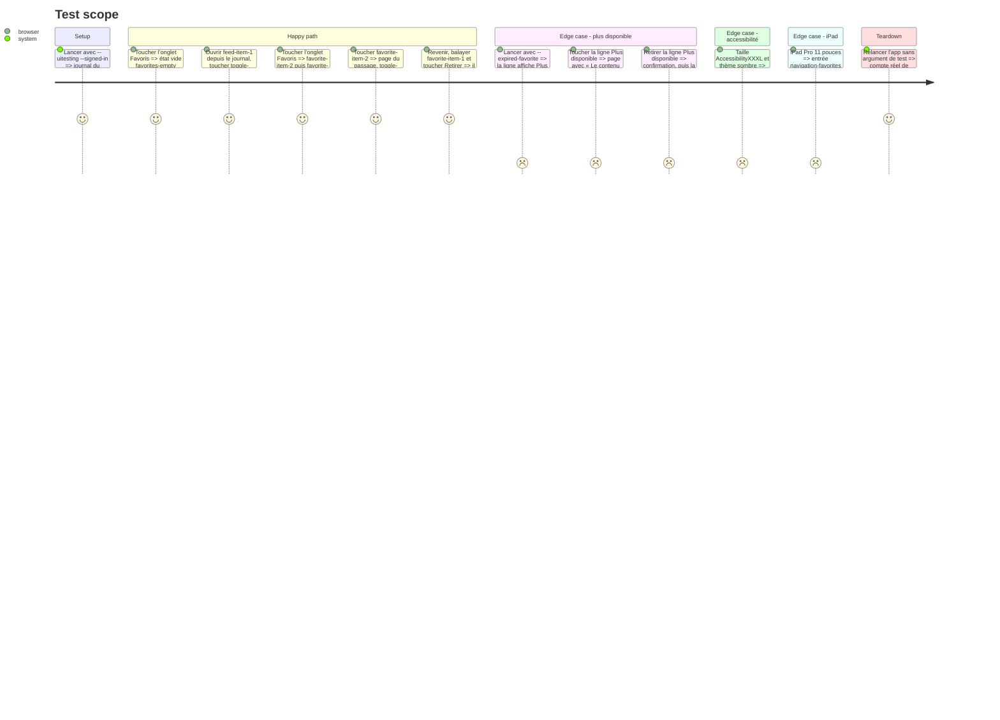

# Instruction: L’onglet « Favoris »

## Architecture projection

> Tree of the final files. ✅ create · ✏️ modify · ❌ delete

```txt
.
├── Infometrie/
│   └── InfometrieApp.swift              ✏️ onglet « Favoris » ★ et entrée de la barre latérale iPad
├── Infometrie/Services/
│   └── AppModel.swift                   ✏️ `Tab.favorites`
├── Infometrie/Views/
│   ├── FavoritesView.swift              ✅ page des favoris, lignes, retrait, état vide
│   └── FeedCard.swift                   ✏️ état « Plus disponible »
├── Infometrie/Fixtures/
│   └── UITestServer.swift               ✏️ `--expired-favorite` ajoute un favori sorti de l’historique
├── InfometrieUITests/
│   └── InfometrieUITests.swift          ✏️ testFavoritesFromPassageListAndRemove, « Favoris » dans `navigationButton`
└── aidd_docs/memory/
    ├── design.md                        ✏️ onglet, étoile, lignes, « Plus disponible », état vide
    ├── navigation.md                    ✏️ quatre destinations, schéma
    ├── project-brief.md                 ✏️ « Key features »
    └── testing.md                       ✏️ argument `--expired-favorite`, parcours dans « UI tests by area »
```

## User Journey



## Test Scope



## Wireframe

```txt
┌───────────────────────────────────────┐
│ (1) Favoris                           │
│     3 passages, les derniers ajoutés  │
│     en premier                        │
├───────────────────────────────────────┤
│ (2)┃ Intervention 09/10 14:52 · 1:24 [logo]
│    ┃ Camille Martin · TEST-A          │
│    ┃ Titre du passage                 │
├───────────────────────────────────────┤
│    ┃ X  08/10 21:03                   │
│    ┃ …                                │
├───────────────────────────────────────┤
│ (3)┃ Citation 02/08 08:10 · Plus      │
│    ┃ disponible                       │
│    ┃ (nom et titre en gris)           │
├───────────────────────────────────────┤
│ (4) Le journal · Mes suivis · ★ Favoris · Compte │
└───────────────────────────────────────┘

Sans favori :
┌───────────────────────────────────────┐
│                                       │
│                 (5) ☆                 │
│       Aucun favori pour l’instant     │
│   Touchez ☆ en haut d’un passage pour │
│          le retrouver ici.            │
│                                       │
└───────────────────────────────────────┘
```

1. Titre de page et nombre de passages avec leur ordre, comme « Mes suivis ».
2. Ligne de favori : la `FeedCard` du journal sur filet, vue ou non comme dans le journal, sans « ★ » : la page entière est faite de favoris.
3. Favori sorti de l’historique : grisé comme un passage vu, « Plus disponible » dans la ligne des faits.
4. Barre d’onglets système, « Favoris » entre « Mes suivis » et « Compte » ; barre latérale sur iPad.
5. État vide centré un peu au-dessus du milieu, comme celui de Mes suivis.

## Tasks to do

### `1)` Quatrième destination

> « Favoris » se trouve au même niveau que le journal et les suivis.

1. `AppModel.Tab` : ajouter `favorites`.
2. `InfometrieApp.swift` : `Tab("Favoris", systemImage: "star", value: .favorites)` entre « Mes suivis » et « Compte », dans son propre `NavigationStack` avec `withMainTabBar()` et `Brand.tint`.
3. Barre latérale iPad : `destination("Favoris", symbol: "star", tab: .favorites, identifier: "navigation-favorites")`, au même rang.
4. Vérifier que quatre onglets tiennent sur l’iPhone 13 mini avec « Tout écouter » réduit à côté.

### `2)` Page « Favoris »

> Retrouver et rouvrir ce qu’on a gardé.

1. Créer `Infometrie/Views/FavoritesView.swift` : page blanc cassé, colonne de lecture, marges `AppLayout`, `PageHeading("Favoris", subtitle: "N passages, les derniers ajoutés en premier")` (« 1 passage » au singulier).
2. Une `FeedCard(item:seen:)` par favori sur filet, sans l’étoile des lignes (toute la page est en favori), dans un `NavigationLink` vers `SequenceView(item:list:)` avec la liste des favoris, identifiant `favorite-item-<id>`.
3. Retrait : balayage « Retirer », appui long et action VoiceOver « Retirer des favoris » ; sans confirmation, sauf pour un favori « Plus disponible » (`confirmationDialog` : il ne pourra plus être ajouté).
4. `scrollEdgeEffectStyle(.soft, for: .bottom)` et barre de navigation opaque couleur de page, comme le journal.
5. Sur iPad, pas de barre de navigation : le titre reste dans la page.

### `3)` « Plus disponible »

> Un favori trop ancien reste reconnaissable et dit pourquoi il ne s’ouvre plus.

1. `FeedCard` : paramètre `unavailable`, qui grise le nom et le titre comme `seen` et ajoute « Plus disponible » à la ligne des faits, dans le même `Text`.
2. Valeur VoiceOver « Plus disponible », avant « Déjà vu » quand les deux s’appliquent.
3. `FavoritesView` passe `favorite.isUnavailable(now:)` ; la ligne reste ouvrable.

### `4)` État vide

> Dire comment remplir la page.

1. Centré dans la hauteur libre, un peu au-dessus du milieu, comme `SuiviEmptyState` : symbole `star` grand en `Brand.accent`, « Aucun favori pour l’instant » (`title3` gras, en-tête VoiceOver), « Touchez ☆ en haut d’un passage, ou restez appuyé sur une ligne du journal, pour le retrouver ici. ».
2. Identifiant `favorites-empty` ; la page défile aux grandes tailles de texte.

### `5)` Parcours UI et mémoire

> Le geste est couvert, la mémoire décrit l’onglet.

1. `UITestServer` : `--expired-favorite` enregistre un favori à identifiant inconnu du serveur (404), daté de 90 jours.
2. `testFavoritesFromPassageListAndRemove` suivant le Test Scope ; ajouter `"Favoris": "navigation-favorites"` à `navigationButton`.
3. `design.md` : onglet, étoile, lignes, « Plus disponible », état vide, `bookmark` réservé aux suivis.
4. `navigation.md` : quatre destinations, schéma avec « Favoris » vers « Séquence ».
5. `project-brief.md` : favoris dans « Key features ».
6. `testing.md` : `--expired-favorite`, ligne « Favoris » dans « UI tests by area ».

## Test acceptance criteria

| Task | Acceptance criteria |
| ---- | ------------------- |
| 1 | L’iPhone montre quatre onglets, « Favoris » avec une étoile entre « Mes suivis » et « Compte » ; l’iPad montre « Favoris » dans la barre latérale. |
| 2 | Deux passages mis en favori apparaissent, le dernier ajouté en premier ; une ligne ouvre sa page, « Passage suivant » mène au favori suivant ; un balayage « Retirer » enlève la ligne. |
| 3 | Un favori daté de plus de 60 jours affiche « Plus disponible », grisé ; l’ouvrir montre « Le contenu demandé n’est plus disponible. » ; le retirer demande une confirmation. |
| 4 | Sans favori, la page montre l’état vide centré, lisible en AccessibilityXXXL et en sombre. |
| 5 | `testFavoritesFromPassageListAndRemove` passe seul sur l’iPhone 17 Pro iOS 26.4 ; les quatre fichiers de mémoire décrivent les favoris. |
