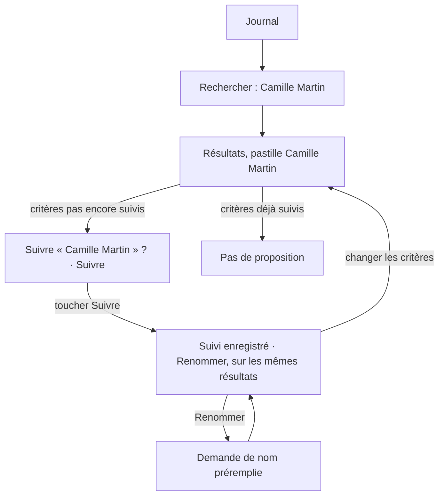
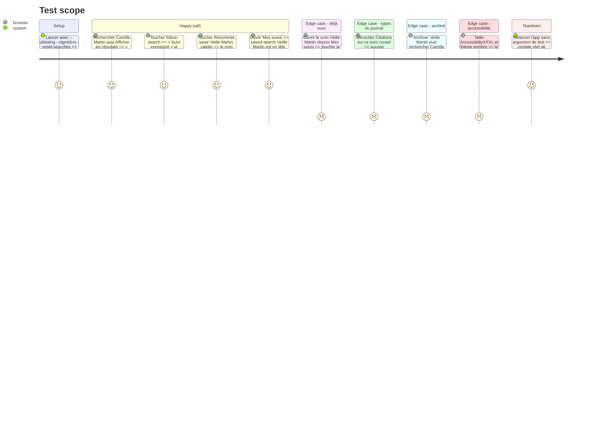

# Instruction: Suivre depuis le journal

## Architecture projection

> Tree of the final files. ✅ create · ✏️ modify · ❌ delete

```txt
.
├── Infometrie/Core/
│   └── Search.swift                     ✏️ nom proposé d’après les critères, même audience, critères masqués sous ce nom
├── Infometrie/Services/
│   └── AppModel.swift                   ✏️ suivi de la recherche courante, suivre (créer ou restaurer), renommer, confirmation
├── Infometrie/Views/
│   ├── FeedView.swift                   ✏️ proposition « Suivre » sous les critères, puis « Suivi enregistré »
│   └── SavedSearchesView.swift          ✏️ « Renommer » dans « ⋯ », demande de nom partagée avec le journal
├── Tests/InfometrieCoreTests/
│   └── CoreTests.swift                  ✏️ nom proposé, même audience
├── InfometrieUITests/
│   └── InfometrieUITests.swift          ✏️ testFollowSearchFromJournalAndRename
└── aidd_docs/memory/
    ├── design.md                        ✏️ proposition de suivre, noms automatiques, « Renommer »
    └── testing.md                       ✏️ nouveau parcours dans « UI tests by area »
```

## User Journey



## Test Scope



## Wireframe

Option A de la planche 06.

```txt
┌───────────────────────────────────────┐
│ infométrie                (Rechercher)│
│ [■ Interventions] [■ Citations] [■ X] │
│  Live   7 j   30 j              ☰  ▥  │
│ Aujourd’hui · à l’instant             │
│ 3 passages                            │
│ (1) (👤 Camille Martin ✕)             │
│ (2) Suivre « Camille Martin » ?       │
│     Retrouvez-le dans Mes  [🔖 Suivre]│
│     suivis                            │
├───────────────────────────────────────┤
│ ┃ Intervention 17:31 · 18 s   [logo]  │
│ ┃ Camille Martin · TEST-A             │
│ ┃ …                                   │
└───────────────────────────────────────┘

Après « Suivre » :
│ (3) 🔖 Suivi enregistré     Renommer  │
│        Retrouvez-le dans Mes suivis   │
```

1. Pastilles des critères, inchangées.
2. Proposition, seulement si aucun suivi actif n’a ces personnes et partis : titre nommant le suivi proposé, rappel de Mes suivis, bouton plein vermillon « Suivre » ; empilée aux tailles d’accessibilité.
3. Confirmation après « Suivre », jusqu’au prochain changement de critères : signet plein bleu canard, « Suivi enregistré », « Renommer ».

## Tasks to do

### `1)` Noms et audience dans Core

> Le nom proposé et la règle « déjà suivi » sont testés sans simulateur.

1. Dans `Search.swift`, ajouter à `SearchFilters` un nom proposé : `summary(parties:)`, suivi de « · » et des types quand il en exclut au moins un (« Groupe de test B · Citations », « Tout le panel · Publications X »).
2. Ajouter une comparaison « même audience » : mêmes personnes et mêmes partis, types ignorés.
3. Faire masquer à `SavedSearch.criteria(parties:)` les critères quand le nom est aussi le nom proposé, pas seulement le résumé.
4. Couvrir les trois dans `CoreTests.swift`.

### `2)` Suivre et renommer dans le modèle

> Un toucher crée le suivi, ou restaure l’archivé qui a ces critères, sans jamais de doublon.

1. Exposer dans `AppModel` le suivi actif de même audience que `filters`, s’il existe.
2. Ajouter `follow()` : si un suivi archivé a la même audience, le restaurer ; sinon créer un `SavedSearch` nommé d’après les critères (noms de partis de `parties`) avec les `filters` courants ; marquer `lastUsedAt`, enregistrer, et retenir l’identifiant pour la confirmation.
3. Effacer cette confirmation quand `apply` change les critères, et à la déconnexion.
4. Ajouter `rename(_:to:)` : nom rogné, ignoré s’il est vide, enregistré.

### `3)` Proposition dans le journal

> La proposition apparaît sous les pastilles là où l’on oublie, et disparaît une fois suivi.

1. Dans `FeedView`, sous `selectionSummary`, afficher la proposition quand il y a des personnes ou des partis et aucun suivi actif de même audience : « Suivre « <nom proposé> » ? », « Retrouvez-le dans Mes suivis » (`subheadline`, `Brand.secondary`), bouton `ActionButtonStyle(prominent: true)` compact « Suivre » avec `bookmark`, identifiant `follow-search`.
2. Après `follow()`, la remplacer par la confirmation : `bookmark.fill` en `Brand.canard`, « Suivi enregistré », « Retrouvez-le dans Mes suivis », bouton texte « Renommer » (identifiant `rename-followed`) ; identifiant de la ligne `follow-confirmation`.
3. Ligne sur filet, marges de la page, rien d’animé en dehors de `.motion` ; aux tailles d’accessibilité, texte puis bouton pleine largeur (`AdaptiveRow`).
4. Retour haptique léger au toucher de « Suivre » (`.sensoryFeedback`).
5. VoiceOver : la proposition se lit en une phrase, le bouton dit « Suivre « <nom> » ».

### `4)` Renommer

> Un nom automatique se corrige en un geste, depuis le journal comme depuis Mes suivis.

1. Créer une demande de nom partagée (alerte avec champ prérempli, « Annuler » et « Renommer », identifiant du champ `rename-field`) dans `SavedSearchesView.swift`, utilisée par le journal et par les lignes de suivi.
2. Ajouter « Renommer » (`pencil`) au menu « ⋯ », à l’appui long et aux actions VoiceOver des lignes actives et archivées.
3. Si l’alerte avec champ ne s’affiche pas comme attendu sur iOS 26.4, se replier sur une petite feuille « Renommer le suivi » et le signaler.

### `5)` Parcours UI et mémoire

> Le nouveau geste est couvert et documenté.

1. Ajouter `testFollowSearchFromJournalAndRename` : recherche Camille Martin, `follow-search`, `follow-confirmation`, renommage, présence dans Mes suivis, réouverture sans proposition.
2. `design.md` : la proposition de suivre et sa confirmation, les noms automatiques, « Renommer ».
3. `testing.md` : ajouter le parcours à la ligne « Suivis, sequence, podcast » de « UI tests by area ».

## Test acceptance criteria

| Task | Acceptance criteria |
| ---- | ------------------- |
| 1 | `swift test` couvre le nom proposé (avec et sans types exclus, sans critère) et la même audience (types ignorés). |
| 2 | Suivre deux fois les mêmes personnes et partis ne crée qu’un suivi ; suivre les critères d’un suivi archivé le restaure sous son nom. |
| 3 | Après une recherche sur Camille Martin, « Suivre « Camille Martin » ? » apparaît sous la pastille ; un toucher affiche « Suivi enregistré » sans quitter les résultats ; un suivi ouvert depuis Mes suivis n’affiche aucune proposition, même après avoir décoché un type. |
| 4 | « Renommer » depuis le journal ou depuis « ⋯ » change le nom affiché dans Mes suivis ; un nom vide ne change rien. |
| 5 | `testFollowSearchFromJournalAndRename` passe seul sur l’iPhone 17 Pro iOS 26.4 ; `design.md` et `testing.md` décrivent le geste. |
