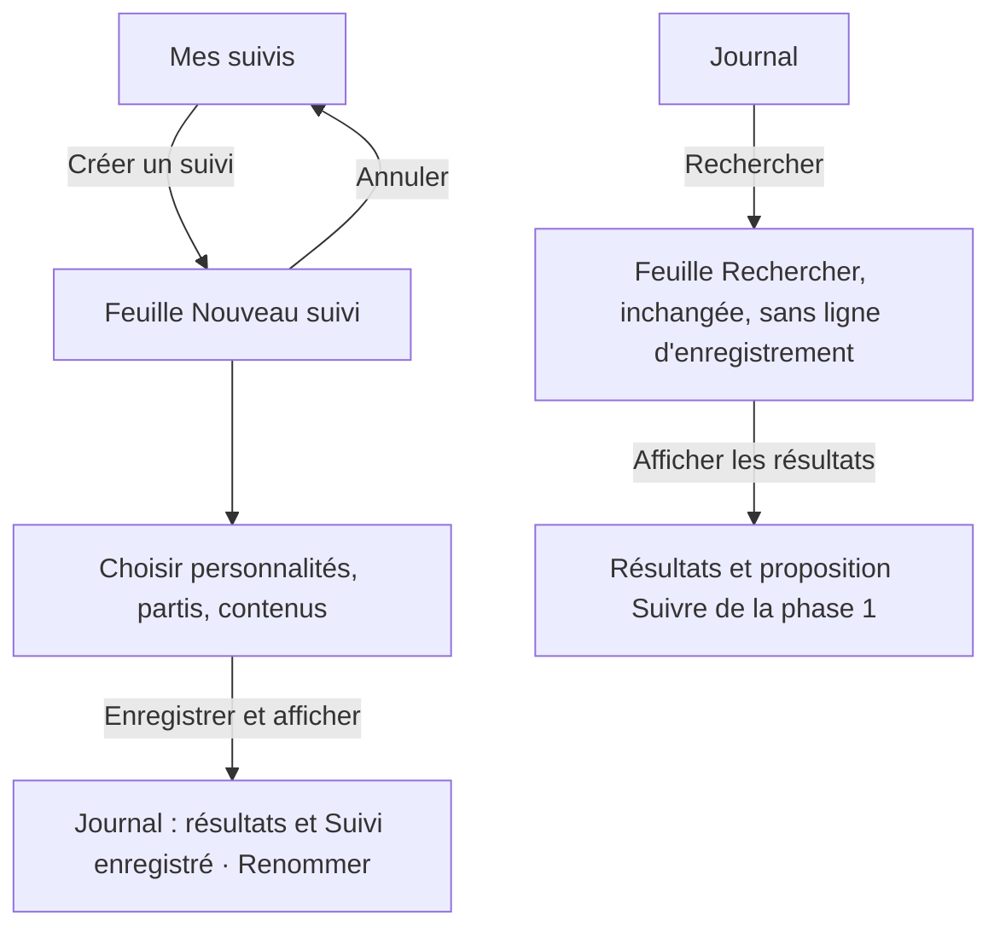
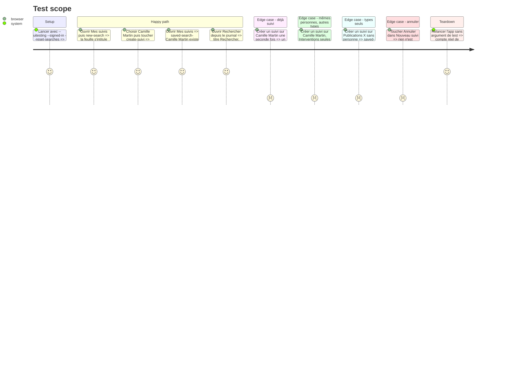

# Instruction: « Créer un suivi » enregistre

## Architecture projection

> Tree of the final files. ✅ create · ✏️ modify · ❌ delete

```txt
.
├── Infometrie/Services/
│   └── AppModel.swift                   ✏️ feuille ouverte pour créer, créer puis afficher, ancien enregistrement nommé retiré
├── Infometrie/Views/
│   └── SearchView.swift                 ✏️ titre « Nouveau suivi », « Enregistrer et afficher », ligne et feuille d’enregistrement retirées
├── InfometrieUITests/
│   └── InfometrieUITests.swift          ✏️ parcours des suivis et des publications X par « Créer un suivi », audit
└── aidd_docs/memory/
    ├── design.md                        ✏️ feuille « Nouveau suivi », fin de la feuille d’enregistrement
    └── navigation.md                    ✏️ la recherche en mode création
```

## User Journey



## Test Scope



## Wireframe

Option B de la planche 06, sans case à cocher.

```txt
┌───────────────────────────────────────┐
│ (1) Annuler        Nouveau suivi      │
├───────────────────────────────────────┤
│ (2) Nouveau suivi                     │
│     Choisissez qui suivre ; il sera   │
│     enregistré dans Mes suivis.       │
│ (3) Qui suivre ?                      │
│     👥 Personnalités         Camille ›│
│     🏛 Partis politiques        Tous ›│
│     Quels contenus ?                  │
│     ◉ Tous les contenus               │
│     ○ Interventions …                 │
├───────────────────────────────────────┤
│ (4) [     Enregistrer et afficher    ]│
└───────────────────────────────────────┘
```

1. Barre de la feuille : « Annuler », titre « Nouveau suivi » au lieu de « Recherche ».
2. Titre et phrase qui disent qu’on crée un suivi.
3. Critères et « Réinitialiser la recherche », inchangés ; plus de ligne « Enregistrer ce suivi ».
4. Une seule action, pleine : enregistrer sous le nom proposé, puis afficher les résultats.

## Tasks to do

### `1)` Mode création dans le modèle

> La feuille sait si elle crée un suivi ou cherche.

1. Ajouter à `AppModel` un état « création » : vrai pour `newSearch()`, faux pour `openSearch(_:)` et à chaque fermeture de la feuille.
2. Ajouter « créer puis afficher » : enregistrer le `draft` sous le nom proposé de la phase 1, sauf si un suivi a exactement ces critères, types compris (actif : rien à créer ; archivé : le restaurer), puis `apply(draft)`, ce qui laisse le journal sur les résultats avec la confirmation. La règle est plus stricte que celle du journal, qui ignore les types : ici l’utilisateur demande explicitement un suivi, et « Camille Martin · Interventions » doit pouvoir exister à côté de « Camille Martin ».
3. Retirer `saveSearch(name:)`, qui n’a plus d’appelant.

### `2)` Feuille « Nouveau suivi »

> Depuis « Créer un suivi », la feuille promet et fait ce que dit le bouton qui l’a ouverte.

1. En mode création, titre de barre « Nouveau suivi », `PageHeading` « Nouveau suivi » et « Choisissez qui suivre ; il sera enregistré dans Mes suivis. », bouton du pied « Enregistrer et afficher » (identifiant `create-suivi`).
2. En recherche, garder « Recherche », « Rechercher », « Afficher les résultats » (`apply-search`).
3. Retirer la ligne « Enregistrer ce suivi » (`save-search`), la feuille « Enregistrer un suivi » (`search-name`, `confirm-save-search`), ses états et `recap`.

### `3)` Parcours UI

> Les parcours qui enregistraient par la feuille de nommage passent par « Créer un suivi ».

1. `testSearchPersistenceSequenceAndPodcast` : créer le suivi depuis Mes suivis (`new-search`, Camille Martin, `create-suivi`), vérifier `saved-search-Camille Martin` ; remplacer le passage « Modifier la recherche → save-search → Annuler » par la vérification que la feuille ouverte par « Modifier la recherche » s’intitule « Recherche » et n’a pas `save-search`.
2. `testPublicationsUseServerKindsResetCursorAndHaveNoAudio` : créer le suivi Publications X par « Créer un suivi » et le retrouver sous `saved-search-Tout le panel · Publications X`.
3. Retirer `save-search` et `confirm-save-search` des listes de l’audit (pied de feuille, identifiants exclus) et y ajouter `create-suivi`.
4. Lancer seuls ces deux parcours et `testFollowSearchFromJournalAndRename`.

### `4)` Mémoire

> La mémoire ne décrit plus la feuille de nommage.

1. `design.md` : retirer « the save sheet » de la règle d’espacement des sections ; décrire la feuille « Nouveau suivi » et son unique action.
2. `navigation.md` : la feuille de recherche s’ouvre aussi en mode « Nouveau suivi » depuis Mes suivis.

## Test acceptance criteria

| Task | Acceptance criteria |
| ---- | ------------------- |
| 1 | « Créer un suivi » puis « Enregistrer et afficher » montre les résultats dans le journal et n’enregistre pas deux fois les mêmes critères, types compris ; un suivi qui ne diffère que par ses types est créé ; « Annuler » n’enregistre rien. |
| 2 | Depuis Mes suivis la feuille dit « Nouveau suivi » et « Enregistrer et afficher » ; depuis le journal elle dit « Rechercher » et « Afficher les résultats » ; aucune des deux n’a de ligne d’enregistrement. |
| 3 | Les trois parcours passent seuls sur l’iPhone 17 Pro iOS 26.4. |
| 4 | `design.md` et `navigation.md` décrivent les deux modes de la feuille et ne mentionnent plus la feuille d’enregistrement. |
