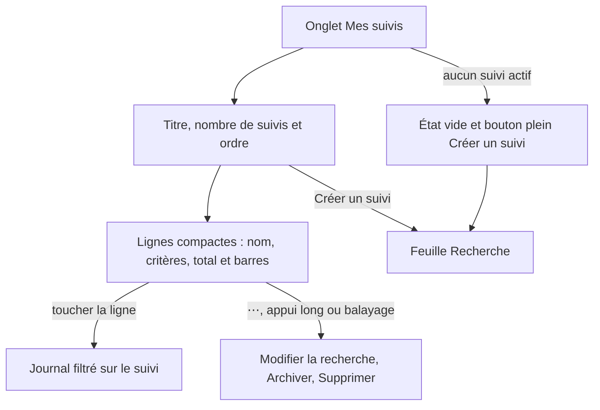
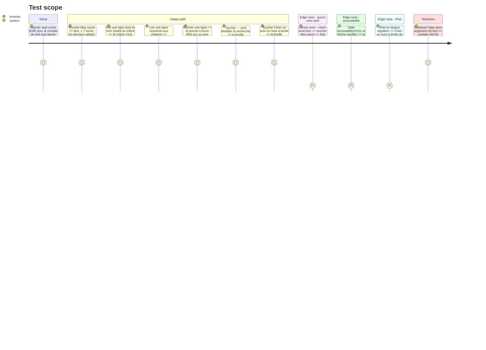

# Instruction: Ligne compacte des suivis actifs

## Architecture projection

> Tree of the final files. ✅ create · ✏️ modify · ❌ delete

```txt
.
├── Infometrie/Core/
│   └── Search.swift                     ✏️ résumé des critères avec les noms de partis
├── Infometrie/Views/
│   └── SavedSearchesView.swift          ✏️ tête de page, « Créer un suivi », légende, ligne compacte, tendance compacte
├── Tests/InfometrieCoreTests/
│   └── CoreTests.swift                  ✏️ résumé : noms de partis, codes inconnus, tout le panel
└── aidd_docs/memory/
    └── design.md                        ✏️ ligne de suivi, place de « Créer un suivi », types nommés seulement quand restreints
```

## User Journey



## Test Scope



## Wireframe

Option A de la planche 05, à 375 pt.

```txt
┌───────────────────────────────────────┐
│ (1) infométrie       + Créer un suivi │
├───────────────────────────────────────┤
│ (2) Mes suivis                        │
│     7 suivis, les derniers utilisés   │
│     en premier                        │
│ (3)              Passages sur 7 jours │
├───────────────────────────────────────┤
│ (4) Ma veille politique      42    ⋯  │
│     Tout le panel          ▃▅▂▇▅▃▆    │
├───────────────────────────────────────┤
│     Camille Martin           47    ⋯  │
│                            ▂▃▅▃▂▅▇    │
├───────────────────────────────────────┤
│     Citations du groupe B    10    ⋯  │
│     Groupe B               ▁▅▃▁▇      │
│ (5) ❝ Citations                       │
├───────────────────────────────────────┤
│     …                                 │
│ (6) [Actifs] (Archivés)  (phase 2)    │
└───────────────────────────────────────┘
```

1. Barre de navigation : logo à gauche, « Créer un suivi » libellé à droite (iPhone). Sur iPad, le bouton se place à droite du titre (2).
2. Titre et sous-titre : nombre de suivis actifs et ordre du tri.
3. Légende unique de la colonne de droite, à la place de « passages sur 7 jours » répété dans chaque ligne.
4. Ligne de suivi : nom en tête, critères (masqués s’ils répètent le nom), total et barres à droite, « ⋯ » ; toute la ligne ouvre le journal.
5. Types nommés seulement quand le suivi en exclut : pictogramme et nom dans la couleur du type, sans fond.
6. Les puces Actifs / Archivés restent jusqu’à la phase 2, sous la liste plutôt qu’au-dessus.

## Tasks to do

### `1)` Critères lisibles

> La ligne de critères nomme les partis comme les pastilles du journal, et ne répète jamais le nom du suivi.

1. Dans `Search.swift`, faire prendre à `SearchFilters.summary` les noms de partis (`[Party]` ou un dictionnaire code → nom) ; un code inconnu reste affiché tel quel ; sans personne ni parti, « Tout le panel ».
2. Supprimer le cas particulier « Toutes les personnalités » de `SavedSearchesView` au profit de « Tout le panel ».
3. Masquer la ligne de critères quand elle est égale au nom du suivi, sans tenir compte de la casse ni des espaces autour.
4. Couvrir le résumé dans `CoreTests.swift` : noms de partis, code inconnu, tout le panel, personnes puis partis dans l’ordre alphabétique.

### `2)` Tête de page

> Le premier suivi commence à environ 120 pt sous la barre de navigation.

1. Remplacer le slogan par le nombre de suivis actifs et l’ordre : « 7 suivis, les derniers utilisés en premier », « 1 suivi » au singulier.
2. Retirer le bouton pleine largeur « Créer un suivi » de la tête de page.
3. Sur iPhone, ajouter « Créer un suivi » (icône `plus` et libellé) en `.topBarTrailing`, sur le modèle de `filtersButton(scheme:)` dans `FeedView.swift` : couleur fixée par `Brand.fixed(_:for:)`, fond partagé caché, identifiant `new-search`.
4. Sur iPad (largeur régulière, barre cachée), placer le même bouton à droite du titre.
5. Sans suivi actif, ne rien mettre en haut à droite : l’état vide garde son bouton plein (`ActionButtonStyle(prominent: true)`, `new-search`).
6. Déplacer les puces Actifs / Archivés sous la liste, identifiants inchangés (`saved-active`, `saved-archived`) ; la phase 2 les remplace.

### `3)` Ligne compacte

> Une ligne d’environ 72 pt par suivi, dont toute la surface ouvre le journal.

1. Ajouter la légende « Passages sur 7 jours » (`footnote` semibold, `Brand.secondary`) alignée à droite au-dessus de la première ligne, sur un filet, seulement s’il y a au moins un suivi actif.
2. Construire la ligne : à gauche le nom (`headline`, `Brand.ink`, sur plusieurs lignes si besoin), les critères (`subheadline`, `Brand.secondary`, une ligne) et les types restreints ; à droite la tendance compacte ; puis « ⋯ ».
3. Types restreints : seulement quand le suivi exclut au moins un type, pictogramme et nom de chaque type coché en `footnote` semibold dans sa couleur `…Label` (`FeedItem.labelColor(ofKind:)`), sans fond ; ils passent en colonne quand ils ne tiennent pas en largeur.
4. Réduire `SuiviTrend` : total en `headline` gras chiffres tabulaires au-dessus de 7 barres de 5 pt, espacées de 3 pt, hautes de 20 pt (`@ScaledMetric`), mêmes couleurs empilées et même squelette pendant le chargement ; identifiant `saved-trend-<nom>` conservé.
5. Rendre la partie gauche et la tendance un seul bouton qui appelle `model.apply(search.filters)`, avec `.buttonStyle(.plain)` pour que le menu « ⋯ » de la même ligne reste indépendant ; identifiant `saved-search-<nom>`.
6. Garder « ⋯ » comme `Menu` (Modifier la recherche, Archiver, Supprimer), cible de 44 pt, identifiant `saved-actions-<nom>`, libellé « Options de <nom> » ; ajouter le même menu en `contextMenu` sur la ligne ; garder les actions de balayage.
7. Retirer de la ligne le bouton « Afficher le journal » et les `KindTag`.
8. Ligne sur filet, comme aujourd’hui ; marges `AppLayout.margin` sur iPhone et `AppLayout.wideMargin` sur iPad.

### `4)` Accessibilité

> La ligne reste lisible et entière à toutes les tailles, et VoiceOver la lit en une fois.

1. Aux tailles d’accessibilité, empiler la ligne : nom, critères, types, puis la tendance sur sa propre ligne en toutes lettres (« 47 passages sur 7 jours » et les barres) ; « ⋯ » reste en haut à droite ; masquer la légende de colonne.
2. Faire du bouton de ligne un seul élément VoiceOver : nom, critères, types restreints, « 47 passages sur 7 jours » ; indice « Affiche le journal de ce suivi » ; actions personnalisées Modifier la recherche, Archiver, Supprimer.
3. Vérifier sur iPhone 13 mini qu’aucun enfant à largeur idéale ne pousse la page hors de l’écran (`design.md`, Accessibility).

### `5)` Mémoire du projet

> `design.md` décrit la page telle qu’elle est livrée.

1. Remplacer, dans `design.md`, le paragraphe « Mes suivis » (tendance de 8 pt sur 32 pt) par la ligne compacte, la légende de colonne et l’ordre annoncé.
2. Remplacer la règle « "Créer un suivi" is prominent only while there is no suivi » par la place du bouton (barre de navigation, à droite du titre sur iPad, plein dans l’état vide).
3. Remplacer « Each suivi lists its kinds as `KindTag`s, as in the feed » par les types nommés seulement quand ils sont restreints.

## Test acceptance criteria

| Task | Acceptance criteria |
| ---- | ------------------- |
| 1 | Un suivi sur un parti affiche le nom du parti venu de `/parties` ; un suivi nommé comme sa seule personnalité n’affiche pas de ligne de critères ; `swift test` couvre le résumé. |
| 2 | Avec sept suivis, le premier commence sous le titre et son sous-titre, sans bouton pleine largeur ni puces au-dessus ; « Créer un suivi » ouvre la feuille Recherche vide depuis la barre de navigation sur iPhone et depuis la droite du titre sur iPad. |
| 2 | Sans suivi actif, l’état vide montre un seul « Créer un suivi », plein, et rien en haut à droite. |
| 3 | Sur iPhone 13 mini, environ sept suivis tiennent au-dessus de la barre d’onglets ; toucher n’importe où sur une ligne hors « ⋯ » ouvre le journal filtré sur ce suivi. |
| 3 | « ⋯ », l’appui long et le balayage proposent les mêmes actions ; Modifier la recherche ouvre la feuille sur les critères du suivi. |
| 4 | En AccessibilityXXXL et en sombre, chaque ligne est empilée, entière et sans texte tronqué hors critères ; VoiceOver lit nom, critères, types et total en un élément et propose les trois actions. |
| 5 | `design.md` ne mentionne plus le bouton pleine largeur, les `KindTag` des suivis ni la tendance de 8 pt sur 32 pt. |
