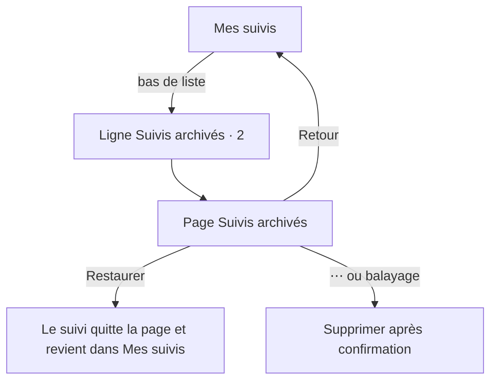
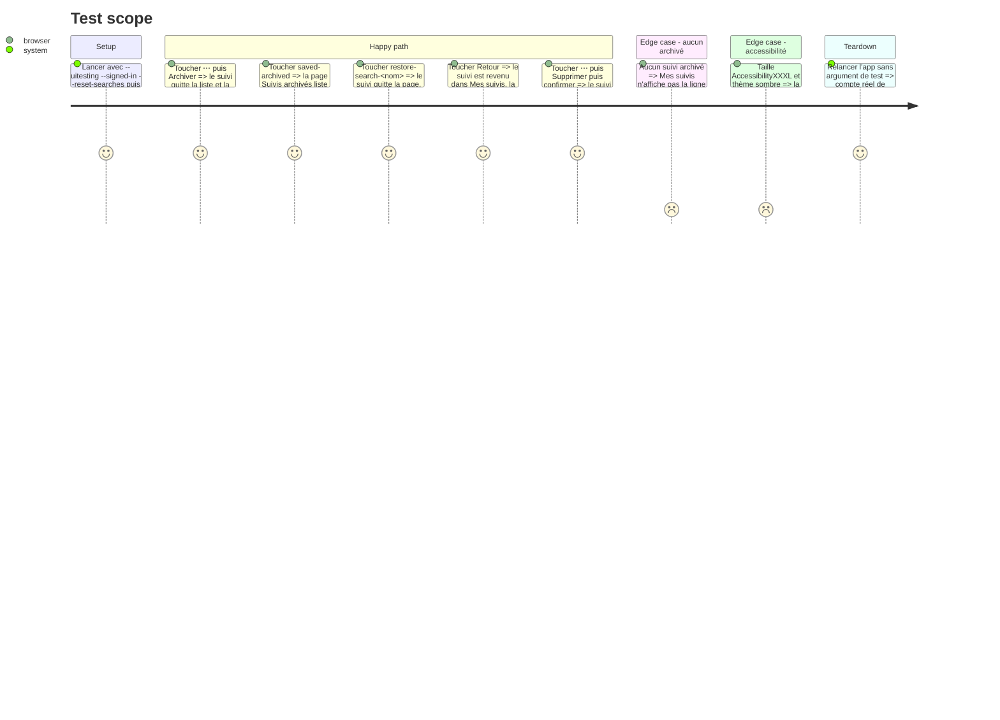

# Instruction: Suivis archivés sur leur propre page

## Architecture projection

> Tree of the final files. ✅ create · ✏️ modify · ❌ delete

```txt
.
├── Infometrie/Views/
│   └── SavedSearchesView.swift          ✏️ puces retirées, ligne « Suivis archivés », page des archivés
├── InfometrieUITests/
│   └── InfometrieUITests.swift          ✏️ testSearchPersistenceSequenceAndPodcast : archiver, ouvrir les archivés, restaurer, revenir
└── aidd_docs/memory/
    ├── design.md                        ✏️ puces Actifs / Archivés retirées de la règle des puces et de la règle de mouvement
    └── navigation.md                    ✏️ Mes suivis → Suivis archivés
```

## User Journey



## Test Scope



## Wireframe

```txt
Mes suivis, bas de liste            Page poussée
┌───────────────────────────────┐   ┌───────────────────────────────┐
│     …                         │   │ (3) ‹         Suivis archivés │
│     Morgan, interventions  23 │   ├───────────────────────────────┤
│     Alex Morgan        ▂▅▃▁ ⋯ │   │ (4) Ancienne veille A       ⋯ │
├───────────────────────────────┤   │     Groupe A                  │
│ (1) ▣ Suivis archivés    2  › │   │     [Restaurer]               │
├───────────────────────────────┤   ├───────────────────────────────┤
│ (2) Vos suivis sont           │   │     Martin avant l'été      ⋯ │
│     enregistrés sur cet       │   │     [Restaurer]               │
│     appareil, pour votre      │   ├───────────────────────────────┤
│     compte.                   │   │ (5) Un suivi archivé peut     │
└───────────────────────────────┘   │     être restauré à tout      │
                                    │     moment.                   │
                                    └───────────────────────────────┘
```

1. Ligne « Suivis archivés » : icône `archivebox`, nombre, chevron ; seulement s’il y a au moins un archivé.
2. Note de stockage existante, inchangée, en fin de page.
3. Page poussée, titre « Suivis archivés », retour système, barre d’onglets cachée comme le passage et la fiche.
4. Ligne d’archivé : nom, critères et types restreints comme en phase 1, sans tendance ; « Restaurer » visible ; « ⋯ » pour Restaurer et Supprimer.
5. Explication sous la liste, ou état vide « Aucun suivi archivé » quand le dernier est restauré.

## Tasks to do

### `1)` Accès aux archivés

> La page principale ne montre que les suivis actifs ; les archivés sont à un toucher, en bas.

1. Retirer les puces Actifs / Archivés et l’état `archived` de `SavedSearchesView`.
2. Ajouter sous la liste, seulement s’il existe un archivé, un `NavigationLink` « Suivis archivés » avec icône, nombre et chevron, 52 pt de haut, identifiant `saved-archived`.
3. Le libellé VoiceOver dit le nombre (« Suivis archivés, 2 »).

### `2)` Page des archivés

> Restaurer ou supprimer un archivé sans quitter sa page.

1. Ajouter dans `SavedSearchesView.swift` une vue de page pour les archivés, titre « Suivis archivés » par `appNavigationTitle`, barre d’onglets cachée par `pushedPage(_:)` (`InfometrieApp.swift`).
2. Réutiliser le texte de gauche de la ligne de la phase 1 (nom, critères, types restreints), sans tendance ni légende, même ordre que la page principale.
3. Ajouter un bouton « Restaurer » visible par ligne (`ActionButtonStyle()`, identifiant `restore-search-<nom>`), un « ⋯ » (Restaurer, Supprimer, identifiant `saved-actions-<nom>`), le même menu en appui long et le balayage existant.
4. Partager la confirmation de suppression entre les deux pages plutôt que de la recopier.
5. Restaurer le dernier archivé laisse la page ouverte sur l’état vide « Aucun suivi archivé ».

### `3)` Parcours UI

> Le parcours des suivis passe avec la nouvelle navigation, assertions inchangées.

1. Dans `testSearchPersistenceSequenceAndPodcast`, après Archiver : toucher `saved-archived`, vérifier le nom sur la page, toucher `restore-search-<nom>`, revenir par le bouton retour de la barre « Suivis archivés » au lieu de `saved-active`, puis supprimer comme aujourd’hui.
2. Lancer seulement ce parcours avec `-only-testing` ; le journal complet reste pour l’avant-push.

### `4)` Mémoire du projet

> La mémoire décrit la navigation et les puces telles qu’elles sont livrées.

1. `design.md` : retirer Actifs / Archivés de la règle des puces (`.chip`) et de la règle de mouvement, et décrire la page des archivés dans le paragraphe « Mes suivis ».
2. `navigation.md` : ajouter « Mes suivis → Suivis archivés » au schéma.

## Test acceptance criteria

| Task | Acceptance criteria |
| ---- | ------------------- |
| 1 | Sans archivé, « Mes suivis » ne montre ni puces ni ligne « Suivis archivés » ; avec deux archivés, la ligne en bas affiche 2 et ouvre la page. |
| 2 | La page des archivés s’ouvre sans barre d’onglets ; « Restaurer » renvoie le suivi dans « Mes suivis » ; Supprimer demande confirmation puis retire le suivi ; le dernier restauré laisse l’état vide. |
| 3 | `testSearchPersistenceSequenceAndPodcast` passe seul sur l’iPhone 17 Pro iOS 26.4. |
| 4 | `design.md` et `navigation.md` ne mentionnent plus les puces Actifs / Archivés et décrivent la page des archivés. |
